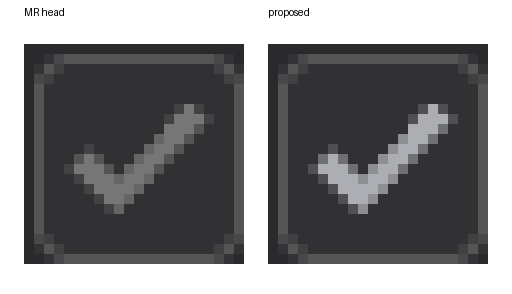

# Drupal MR !16166 — checkmark family evidence

**Status:** first milestone, stop point. One confirmed regression, one minimal proposed fix. No upstream push or comment.

**Baseline:** before `29b0a0b2256eb5ed27df6ec5e4e4e33142a717e8`; MR !16166 head `fe4adb4f942385912bb3244b570afa475cadf3bd`.

`refs/merge-requests/16166/head` resolved to `fe4adb4...` at review time. The cached `after` ref matched it. The historical inventory reproduced: 194 before, 74 after, 204 rows, 77 unresolved, 63 relocated, 54 candidate replacements, 10 after-side unmatched.

**Scope:** checkmark family only (13 original assets, 4 after-side assets, 1 proposed asset). The other 181 original assets are not reconciled in this milestone.

## What the MR does with checkmarks

| Original | Disposition | Replacement / evidence |
|---|---|---|
| `migration/media/icons/form/checked.svg` | Relocated without modification | `images/icons/check.svg` — SHA-256 `a51b10ca...` in both revisions. Backs `--admin-icon-check`, `-checked`, `-checkmark`. |
| `migration/media/icons/form/toggle-unchecked.svg` | Relocated without modification | `images/icons/toggle-unchecked.svg` — SHA-256 `213e711a...` in both revisions. |
| `migration/media/icons/action-link/checkmark.svg` | Replaced (intentional redesign) | `images/icons/check.svg`. Stroked polyline becomes filled canonical check; still monochrome, non-directional, mask-rendered. |
| `images/icons/ffffff/checkmark-sm.svg` | Replaced (derived pretint) | `images/icons/pretint/check-inverse.svg` (`#ffffff`). Same white role, new 24×24 canonical geometry. |
| `images/icons/82828c/checkmark.svg` | Replaced (derived pretint) | `images/icons/pretint/check-disabled.svg` (`#767676`). Checked+disabled checkbox, light mode. |
| `images/icons/002e9a/checkmark.svg` and 6 other colour variants, plus `ffffff/checkmark.svg` | Confirmed unused and removed | No exact path reference anywhere in core at the before revision; the only basename references point to action-link/checkmark.svg and 82828c/checkmark.svg. No dynamic `images/icons/<hex>/checkmark*.svg` construction was found. Absence of a reference is not proof that third-party or user configuration never used the file. |

All before/after checkmark files, source references and confidence are in `reconciliation.json` and `reconciliation.md`.

## Confirmed regression

**CHK-001 — dark-mode disabled checked checkbox check loses contrast.**

* Before: `#82828c` on the dark disabled surface `#313134` = **3.41:1**.
* MR head: `#767676` on `#313134` = **2.85:1**.
* Light mode improved: `#82828c` on `#eaeaea` 3.16:1 → `#767676` **3.78:1**.

The MR replaced the unused colour variants correctly, but the single disabled-check asset was aligned to gray-700 without a dark-mode counterpart. The checked state remains present but is markedly less distinguishable in dark mode. Disabled controls are exempt from WCAG 2.2 SC 1.4.11; this is reported as a measurable state-visibility regression, not a WCAG failure claim.



## Proposed fix (smallest appropriate change)

* Add `images/icons/pretint/check-disabled-inverse.svg` — same path data as `check.svg`, fill `#adaeb3` (`--admin-color-gray-400`, the dark disabled foreground token).
* Register `--admin-icon-checked-disabled-inverse` in `css/base/icons.pcss.css` and the compiled `icons.css`.
* Add one dark-mode rule for `.form-boolean--type-checkbox[disabled]:checked`; light mode keeps `check-disabled.svg` unchanged.
* Add `proposed/tests/checkmark_regression.py` (6 stdlib tests: asset validity, geometry parity, token registration, compiled data-URI parity, dark rule, contrast).
* Full patch: `proposed/interdiff-checkmark.patch` (verified with `git apply --check`).

Measured result: `#adaeb3` on `#313134` = **5.85:1**. Light mode remains **3.78:1**. Forced-colours screenshots are identical to MR head (the checkbox uses native appearance under forced colours).

## Suggested commit split (local only, not pushed)

1. Add `pretint/check-disabled-inverse.svg` and register `--admin-icon-checked-disabled-inverse` (asset + registry).
2. Add the dark-mode checked+disabled checkbox rule (component CSS and compiled CSS).
3. Add `proposed/tests/checkmark_regression.py` and the evidence reports (lab only; not part of the Drupal patch).

`proposed/interdiff-checkmark.patch` contains the Drupal theme changes only and applies to the MR head with `git apply -p1`. The test and reports live under `proposed/` in the review lab.

## Rendering evidence

* Actual component size: 21×21 CSS px for `.form-boolean--type-checkbox`.
* States: unchecked, checked, checked disabled, checked error, hover, active, keyboard focus-visible, light, dark, forced-colours light, forced-colours dark.
* Size matrix: 12, 16, 21 (actual), 24 px — check remains visible.
* Focus: `:focus-visible` true, 1px outline, offset 2px; light `rgb(0,95,204)`, dark `rgb(153,200,255)`.
* Pixel diff (dark after vs proposed): bounding box `[4,87,17,99]` in a 416×184 screenshot — only the disabled checkbox changed. Light after vs proposed: no difference.
* Checked states: white on `#015efe` = 5.21:1 (light); black on `#c4d1ff` = 13.91:1 (dark).
* Screenshots: `proposed/reports/screens/`.
* Forced colours use Chromium media emulation, not native Windows High Contrast.

## Live Drupal integration test

Tested on the running Drupal Core Lab site at `https://repro-baseline-main.ddev.site/admin/people/permissions` (Drupal 12-dev `d29add7e`), where the Administrator column renders **91 checked and disabled checkboxes**. The MR-head check assets and component CSS were applied to the lab's baseline `default_admin` theme, caches rebuilt, measured, then the proposed fix was added and measured again. The baseline theme was restored exactly afterwards (directory diff empty).

| State | Background | Check | Contrast |
|---|---|---|---|
| MR head, light | `rgb(234,234,234)` | `#767676` | **3.78:1** |
| MR head, dark | `rgb(49,49,52)` | `#767676` | **2.85:1** |
| Proposed, light | `rgb(234,234,234)` | `#767676` | **3.78:1** |
| Proposed, dark | `rgb(49,49,52)` | `#adaeb3` | **5.85:1** |

The live Drupal measurements match the isolated harness exactly. The affected control is 21x21 CSS px. Forced light and forced dark retain the native checkbox appearance and the checked state remains visible (`appearance: auto`).

Screenshots: `screens/live-mr-light-disabled.png`, `screens/live-mr-dark-disabled.png`, `screens/live-proposed-light-disabled.png`, `screens/live-proposed-dark-disabled.png`, `screens/live-proposed-forced-light-disabled.png`, `screens/live-proposed-forced-dark-disabled.png`, `screens/live-mr-dark-row.png`, `screens/live-proposed-dark-row.png`.

## Validation

* Proposed theme inventory: 61 SVGs; 0 structural errors (14 unused assets removed, status/required optimised).
* New SVG: valid XML, SVG namespace, `viewBox="0 0 24 24"`, no external content, path data identical to `check.svg`, fill `#adaeb3`.
* 81 SVG references in the proposed theme resolve; 0 missing.
* Compiled data-URI payload matches the source SVG (viewBox, path `d`, fill).
* Validation is partial structural checking, not full SVG conformance.

## Limits / outstanding work

* The live Drupal test applied only the MR checkmark files/CSS to the baseline theme, not the complete MR theme. The lab core is `d29add7e`; the MR head is `fe4adb4`. Full-theme integration remains to be verified.
* Native Windows High Contrast testing remains outstanding.
* The checkmark family is the only reconciled family; 181 assets remain.
* No claim of full SVG or WCAG conformance.
* No upstream push or issue comment has been made.

## Reproduce

```sh
# Snapshot and MR verification
git --git-dir=drupal.git rev-parse refs/heads/before refs/heads/after
git ls-remote https://git.drupalcode.org/project/drupal.git refs/merge-requests/16166/head

# Static checks and tests
python3 proposed/tests/checkmark_regression.py
git apply --check -p1 proposed/interdiff-checkmark.patch

# Lab inventory of the proposed tree (run in a temporary directory)
python3 review.py --before before/core/themes/default_admin \
                  --after proposed/core/themes/default_admin
```
