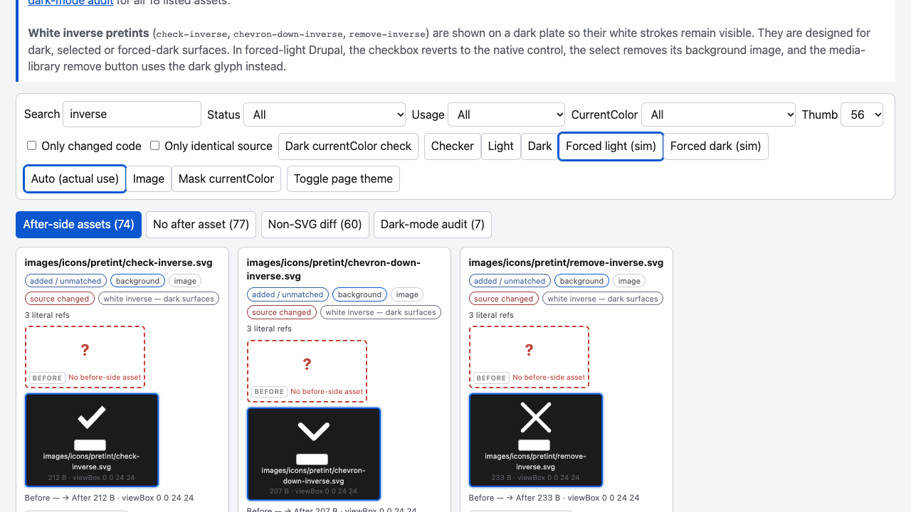
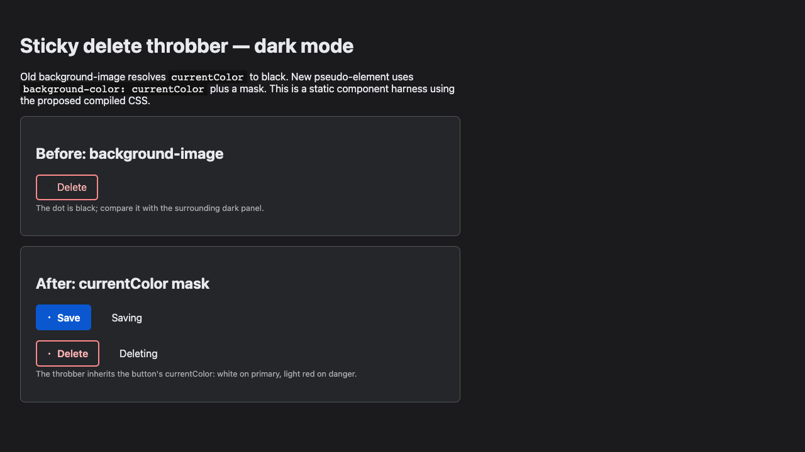

# CurrentColor icons in dark mode — the 18 assets you flagged

**Scope:** `appearance`, `blocks`, `bookmarks`, `chevron-left`, `content`, `files`, `loader`, `media`, `menu`, `nav-toggle-left`, `nav-toggle-top`, `people`, `reports`, `search`, `structure`, `user`, `pretint/chevron-down-default`, `pretint/remove-default`.

This is a source/consumer audit, not a claim that every black thumbnail is a Drupal failure.

## Verdict summary

| Group | Assets | Dark-mode result | Verdict |
|---|---|---|---|
| Unused after assets | 16: the 14 named module/toolbar icons plus `pretint/chevron-down-default` and `pretint/remove-default` | No Drupal consumer. As an ``/`background-image`, `currentColor` resolves to black; as a mask/inline SVG it would inherit the text colour. | **14 removed in the proposed cleanup**; `search` and `chevron-left` remain pending removal/attachment |
| Inline currentColor | `menu.svg` | Included inline in `menu-local-task.html.twig`; `currentColor` inherits the surrounding text colour, so it is light in dark mode | **Not a bug**; the gallery’s Image mode shows it black, which is why it looked wrong |
| Background `currentColor` | `loader.svg` | Used as `background-image` in `more-actions.pcss.css`; `currentColor` cannot inherit through a background image and resolves to black | **Confirmed dark-mode bug**; fixed in the proposed pseudo-element/mask patch |

## White inverse pretints

`pretint/check-inverse.svg`, `pretint/chevron-down-inverse.svg` and `pretint/remove-inverse.svg` are **white by design**. They disappear on a white preview plate, but that does not mean the files are missing.



| Asset | Consumer | Forced-light behaviour |
|---|---|---|
| `check-inverse.svg` | Checked checkbox background, `form--checkbox-radio.pcss.css` | Forced colours sets `appearance: revert`, so the native checkbox is used; the white pretint is not the forced-light control |
| `chevron-down-inverse.svg` | `.dark-mode` select, `form--select.pcss.css` | The forced-colours select rule removes `background-image` and uses the native arrow |
| `remove-inverse.svg` | Dark mode and forced-dark media-library remove, `media-library-item.pcss.css` | Forced light uses the dark `remove` glyph; the inverse glyph is for dark/forced-dark surfaces. The `:active` rule also uses the inverse and should be checked in a real forced-light component |

The gallery now detects `-inverse.svg`, renders these on a dark plate, and labels them **white inverse — dark surfaces**. It also labels them **no before counterpart** rather than “source changed”.

## Why the gallery showed them as black

The gallery’s Image mode renders each SVG through an `` element. An external SVG has no inherited `currentColor`, so the browser uses black. That is **not** how an inline SVG or a CSS mask behaves:

- **Mask:** the SVG shape is used as an alpha mask, and the CSS `background-color` supplies the visible colour.
- **Inline SVG:** `currentColor` inherits the text colour.
- **Background image:** the SVG is rasterised on its own; `currentColor` becomes black.

The gallery now labels this explicitly:

- **unused — no consumer**: shown on a light plate; no Drupal dark rendering exists.
- **inline currentColor — inherits**: `menu` is previewed as a mask.
- **background currentColor — black**: `loader` is marked as a real risk.

## The real loader problem

`after/core/themes/default_admin/css/components/more-actions.pcss.css:66`:

```css
background-image: var(--admin-icon-loader);
```

`loader.svg` uses `stroke="currentColor"`. A background image cannot inherit `currentColor`, so the sticky Save/Preview/Delete throbber is black. On a dark page, and on a transparent danger button, it disappears. The fix is to render the loader through a pseudo-element using `background-color: currentColor` plus a mask, or to provide a mode-specific pretinted loader.



The proposed pseudo-element is in `interdiff-loader-currentcolor.patch`. It keeps the button background intact, draws the loader with `background-color: currentColor` and a mask, preserves the throb animation through `mask-position`/`mask-size`, and disables the animation under `prefers-reduced-motion: reduce`.

Static harness: `proposed/test/loader-dark.html`. It uses the proposed compiled CSS and Drupal's real `body:has([data-drupal-selector="edit-delete"] + .ajax-progress)` selector.

## What to do

1. **Remove the 16 unused after assets** (14 are already removed in the proposed cleanup; `search` and `chevron-left` remain) or attach them to a component with a real mask/inline use.
2. **Keep `menu.svg` unchanged**; it is inline and inherits correctly.
3. **Fix `loader.svg` usage** with a currentColor mask/pseudo-element or a tested pretint.
4. Do not treat black `` thumbnails of `currentColor` SVGs as evidence of a dark-mode failure; test the actual consumer.
