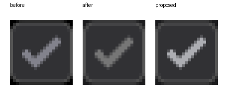

# Checkmark family reconciliation

Generated: 2026-11-24T19:44:58.625312+00:00

**Scope:** checkmark family only. Baseline before `29b0a0b...`, MR !16166 head `fe4adb4...`. Full 194-asset reconciliation is pending; 181 assets outside this family are not classified here.

## Summary

- **beforeFamilyAssets:** 13
- **usedBeforeAssets:** 5
- **unusedBeforeAssets:** 8
- **relocatedUnchanged:** 2
- **replacedOrRedesigned:** 3
- **confirmedUnusedRemoved:** 8
- **unresolved:** 0
- **afterFamilyAssets:** 4
- **confirmedRegressions:** 1
- **proposedNewAssets:** 1

## Original assets

| Original SVG (theme-relative) | Disposition | Replacement / mapping | Confidence | Source evidence |
|---|---|---|---|---|
| `images/icons/002e9a/checkmark.svg` | Confirmed unused and removed | `—` | medium-high | No exact-path, basename-resolved or dynamic reference in core before; only unrelated action-link/82828c basename hits. Absence is evidence, not proof of non-use. No reference to this exact colour-directory path exists in Drupal core at the before revision. The only core basename references point to action-link/checkmark.svg and 82828c/checkmark.svg, not to this variant. No dynamic construction of images/icons/<hex>/checkmark*.svg was found. Removal is consistent with consolidation; absence of a reference is not proof that third-party code or user configuration never used the file. |
| `images/icons/0036b1/checkmark.svg` | Confirmed unused and removed | `—` | medium-high | No exact-path, basename-resolved or dynamic reference in core before; only unrelated action-link/82828c basename hits. Absence is evidence, not proof of non-use. No reference to this exact colour-directory path exists in Drupal core at the before revision. The only core basename references point to action-link/checkmark.svg and 82828c/checkmark.svg, not to this variant. No dynamic construction of images/icons/<hex>/checkmark*.svg was found. Removal is consistent with consolidation; absence of a reference is not proof that third-party code or user configuration never used the file. |
| `images/icons/42a877/checkmark.svg` | Confirmed unused and removed | `—` | medium-high | No exact-path, basename-resolved or dynamic reference in core before; only unrelated action-link/82828c basename hits. Absence is evidence, not proof of non-use. No reference to this exact colour-directory path exists in Drupal core at the before revision. The only core basename references point to action-link/checkmark.svg and 82828c/checkmark.svg, not to this variant. No dynamic construction of images/icons/<hex>/checkmark*.svg was found. Removal is consistent with consolidation; absence of a reference is not proof that third-party code or user configuration never used the file. |
| `images/icons/545560/checkmark.svg` | Confirmed unused and removed | `—` | medium-high | No exact-path, basename-resolved or dynamic reference in core before; only unrelated action-link/82828c basename hits. Absence is evidence, not proof of non-use. No reference to this exact colour-directory path exists in Drupal core at the before revision. The only core basename references point to action-link/checkmark.svg and 82828c/checkmark.svg, not to this variant. No dynamic construction of images/icons/<hex>/checkmark*.svg was found. Removal is consistent with consolidation; absence of a reference is not proof that third-party code or user configuration never used the file. |
| `images/icons/ab1b1b/checkmark.svg` | Confirmed unused and removed | `—` | medium-high | No exact-path, basename-resolved or dynamic reference in core before; only unrelated action-link/82828c basename hits. Absence is evidence, not proof of non-use. No reference to this exact colour-directory path exists in Drupal core at the before revision. The only core basename references point to action-link/checkmark.svg and 82828c/checkmark.svg, not to this variant. No dynamic construction of images/icons/<hex>/checkmark*.svg was found. Removal is consistent with consolidation; absence of a reference is not proof that third-party code or user configuration never used the file. |
| `images/icons/c11f1f/checkmark.svg` | Confirmed unused and removed | `—` | medium-high | No exact-path, basename-resolved or dynamic reference in core before; only unrelated action-link/82828c basename hits. Absence is evidence, not proof of non-use. No reference to this exact colour-directory path exists in Drupal core at the before revision. The only core basename references point to action-link/checkmark.svg and 82828c/checkmark.svg, not to this variant. No dynamic construction of images/icons/<hex>/checkmark*.svg was found. Removal is consistent with consolidation; absence of a reference is not proof that third-party code or user configuration never used the file. |
| `images/icons/d72222/checkmark.svg` | Confirmed unused and removed | `—` | medium-high | No exact-path, basename-resolved or dynamic reference in core before; only unrelated action-link/82828c basename hits. Absence is evidence, not proof of non-use. No reference to this exact colour-directory path exists in Drupal core at the before revision. The only core basename references point to action-link/checkmark.svg and 82828c/checkmark.svg, not to this variant. No dynamic construction of images/icons/<hex>/checkmark*.svg was found. Removal is consistent with consolidation; absence of a reference is not proof that third-party code or user configuration never used the file. |
| `images/icons/ffffff/checkmark.svg` | Confirmed unused and removed | `—` | medium-high | No exact-path, basename-resolved or dynamic reference in core before; only unrelated action-link/82828c basename hits. Absence is evidence, not proof of non-use. No reference to this exact colour-directory path exists in Drupal core at the before revision. The only core basename references point to action-link/checkmark.svg and 82828c/checkmark.svg, not to this variant. No dynamic construction of images/icons/<hex>/checkmark*.svg was found. Removal is consistent with consolidation; absence of a reference is not proof that third-party code or user configuration never used the file. |
| `images/icons/82828c/checkmark.svg` | Replaced by differently named SVG | `images/icons/pretint/check-disabled.svg` | high | `css/components/form--checkbox-radio.pcss.css:223`; `css/components/form--checkbox-radio.css:230`. Disabled checked checkbox icon. The old 16x16 hard-coded #82828c check was replaced by images/icons/pretint/check-disabled.svg, derived from check.svg with #767676. Geometry changed to the canonical 24x24 check glyph. |
| `images/icons/ffffff/checkmark-sm.svg` | Replaced by differently named SVG | `images/icons/pretint/check-inverse.svg` | high | `css/components/form--checkbox-radio.pcss.css:144`; `css/components/form--checkbox-radio.css:151`. Checked checkbox icon in light mode. The old 16x16 white check was replaced by images/icons/pretint/check-inverse.svg, derived from check.svg with #ffffff. Geometry changed to the canonical 24x24 check glyph. |
| `migration/media/icons/action-link/checkmark.svg` | Replaced by differently named SVG | `images/icons/check.svg` | high | `css/base/icons.pcss.css:11`; `css/components/action-link.pcss.css:187`; `css/base/icons.css:17`; `css/components/action-link.css:197`. Action-link checkmark icon (--admin-icon-checkmark). The old stroked polyline check was replaced by the canonical filled check.svg. This is an intentional icon-family redesign: the check remains monochrome, non-directional and mask-rendered, but its stroke/fill construction changes. |
| `migration/media/icons/form/checked.svg` | Relocated without modification | `images/icons/check.svg` | high | `css/base/icons.pcss.css:10`; `css/components/form--checkbox-radio.pcss.css:148`; `css/components/form--checkbox-toggle.pcss.css:111`; `css/base/icons.css:16`; `css/components/form--checkbox-radio.css:155`; `css/components/form--checkbox-toggle.css:118`. Exact hash match with images/icons/check.svg. The same file content moved from the migration staging tree to the public icon registry and now backs --admin-icon-check, --admin-icon-checked and --admin-icon-checkmark. |
| `migration/media/icons/form/toggle-unchecked.svg` | Relocated without modification | `images/icons/toggle-unchecked.svg` | high | `css/base/icons.pcss.css:57`; `css/components/form--checkbox-toggle.pcss.css:149`; `css/base/icons.css:63`; `css/components/form--checkbox-toggle.css:156`; `css/base/icons.css:74`; `css/components/form--checkbox-toggle.css:156`. Exact hash match with images/icons/toggle-unchecked.svg. |

## Replacement and derived assets

| After SVG (theme-relative) | Role | Derived from | Fill | References |
|---|---|---|---|---|
| `images/icons/check.svg` | Canonical monochrome check master | — | currentColor | `css/base/icons.pcss.css:19`; `css/base/icons.pcss.css:20`; `css/base/icons.pcss.css:21`; `css/base/icons.css:25`; `css/base/icons.css:26`; `css/base/icons.css:27` |
| `images/icons/pretint/check-inverse.svg` | Pretinted checked checkbox (light) | images/icons/check.svg | #ffffff | `css/base/icons.pcss.css:101`; `css/components/form--checkbox-radio.pcss.css:144`; `css/base/icons.css:107`; `css/components/form--checkbox-radio.css:151` |
| `images/icons/pretint/check-disabled.svg` | Pretinted disabled checked checkbox (light) | images/icons/check.svg | #767676 | `css/base/icons.pcss.css:102`; `css/components/form--checkbox-radio.pcss.css:225`; `css/base/icons.css:108`; `css/components/form--checkbox-radio.css:232` |
| `images/icons/toggle-unchecked.svg` | Toggle unchecked master | — | currentColor | `css/base/icons.pcss.css:68` |

## Confirmed regression in the checkmark family

`images/icons/82828c/checkmark.svg` was the only used colour variant. MR !16166 replaced its disabled-checked checkbox image with `pretint/check-disabled.svg` (`#767676`) but did not add a dark-mode variant. On the dark disabled surface (`#313134`) the rendered check contrast drops from **3.41:1 to 2.85:1**. This was reproduced in the live Drupal 12 lab at `/admin/people/permissions`, where the Administrator column renders 91 checked and disabled checkboxes. Light mode improves from 3.16:1 to 3.78:1. Disabled controls are exempt from WCAG 2.2 SC 1.4.11, but the checked state became harder to distinguish and the regression is measurable and easy to prevent.

Proposed fix: add `images/icons/pretint/check-disabled-inverse.svg` (`#adaeb3`, the gray-400 token used for disabled foreground), register it as `--admin-icon-checked-disabled-inverse`, and use it only under `.dark-mode`. Measured rendered contrast becomes **5.85:1**. Geometry is unchanged from `check.svg`; light mode and forced-colours output are unchanged.



## Proposed changes

- `images/icons/pretint/check-disabled-inverse.svg` — Add pretinted disabled check for dark mode. MR head uses #767676 on the dark disabled surface (#313134), 2.85:1. The new value is 5.85:1 and matches the disabled foreground token. Geometry is unchanged from check.svg.
- `css/base/icons.pcss.css (+ compiled icons.css)` — Register --admin-icon-checked-disabled-inverse. Theme registry consistency; generated CSS data URI verified to match the source SVG.
- `css/components/form--checkbox-radio.pcss.css (+ compiled .css)` — Use the new pretint only in .dark-mode for checked+disabled checkboxes. Keeps light-mode output unchanged while restoring >=3:1 in dark mode.
- `proposed/tests/checkmark_regression.py` — Add static regression checks. Covers asset validity, token registration, compiled/source parity, dark rule, and contrast.

## Known limitations

- Whole-core literal searches and dynamic-path inspection cannot prove an asset is never used; absence is evidence, not proof (see AGENTS.md).
- Live Drupal 12 (`https://repro-baseline-main.ddev.site/admin/people/permissions`, core `d29add7e`) was tested with the MR checkmark files/CSS applied surgically to the baseline theme; the full MR theme was not installed. The baseline theme was restored exactly afterwards.
- Forced-colours results use Chromium media emulation, not native Windows High Contrast. Native Windows verification remains outstanding.
- Only the checkmark family was reconciled; 181 assets from the wider inventory remain pending.
- Reduced motion and RTL are not applicable to the non-directional check glyph; RTL toggle positioning is unchanged.
- Automated pixel/contrast checks do not establish WCAG conformance.

## Search evidence

```sh
git --git-dir=drupal.git grep -n -F 'images/icons/<colour>/checkmark.svg' before -- core
git --git-dir=drupal.git grep -n -F 'checkmark.svg' before -- core
git --git-dir=drupal.git grep -n -F 'check-disabled' after -- core/themes/default_admin
python3 proposed/tests/checkmark_regression.py
```

